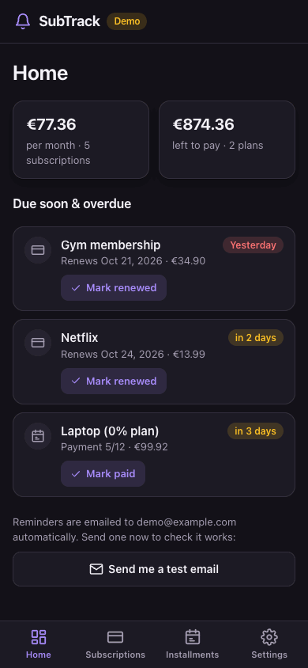
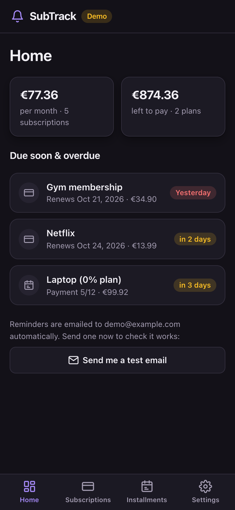
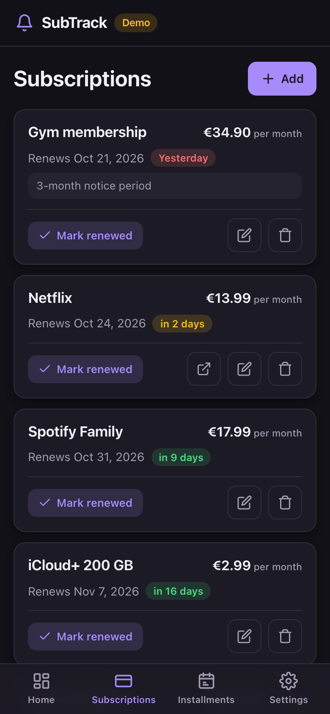
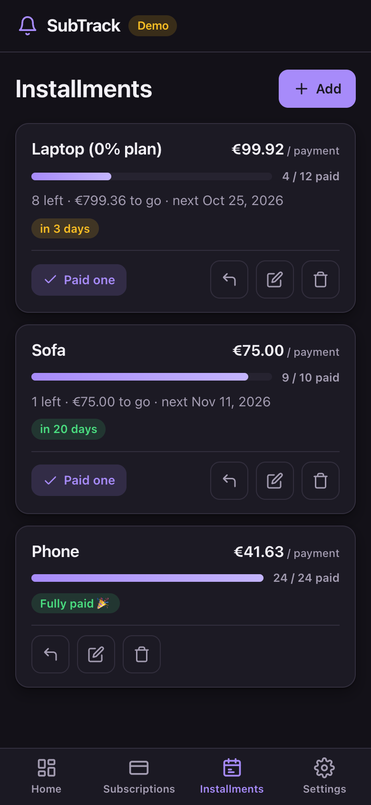
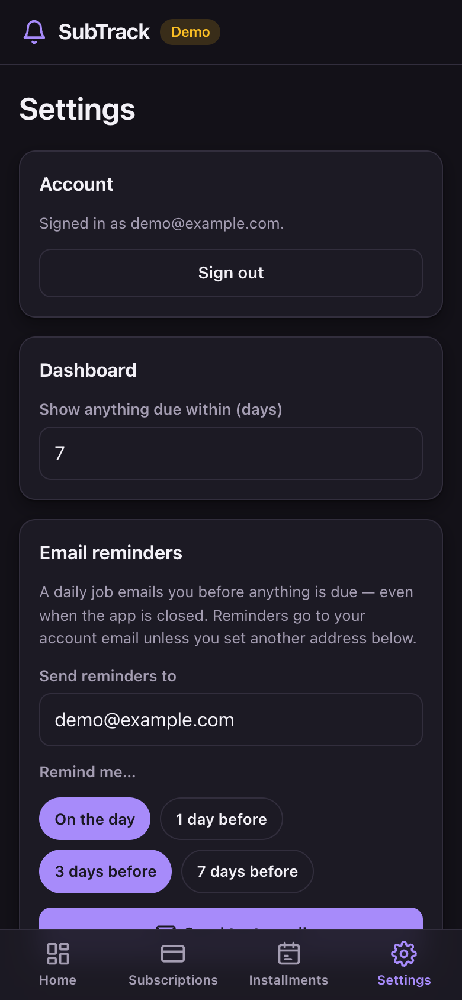

# SubTrack

[](https://github.com/ramazankarisan/subscription-tracker/actions/workflows/ci.yml)

**A phone-first PWA that tells you before a subscription renews or an installment
is due, and emails you even when the app is closed.** Built end to end, from
React UI to Postgres row-level security, with a disciplined AI-agent workflow.

**[Live app](https://ramazankarisan.github.io/subscription-tracker/)** (sign in
with an email code) · or run the demo locally with `pnpm dev:demo` (sample data,
no account)

<p align="center">
  
</p>

|                                Home                                |                            Subscriptions                            |                             Installments                             |                          Settings                           |
| :----------------------------------------------------------------: | :-----------------------------------------------------------------: | :------------------------------------------------------------------: | :---------------------------------------------------------: |
|  |  |  |  |

Screenshots and GIF come from demo mode's synthetic data.

## Why it exists

Free trials turn into charges and installment plans are easy to lose track of.
SubTrack answers one question at a glance: _what's about to charge me, and what do
I still owe?_ It runs entirely on free tiers ($0), and that is a hard product
constraint. The product brief is in [`PRODUCT.md`](PRODUCT.md) and the design
system in [`DESIGN.md`](DESIGN.md).

## What it shows

**Frontend (the focus)**

- React 19 + strict TypeScript, no UI library; a small design system of CSS
  tokens with light and dark themes.
- One store ([`useAppData`](src/state/useAppData.tsx)) owns all data. Actions are
  optimistic, an offline cache renders instantly, and every write goes through
  one `persist()`: a failed write reverts to server truth and shows a banner
  instead of losing data silently.
- Live sync across devices (Supabase Realtime plus refetch on focus/reconnect,
  coalesced and debounced).
- Accessibility basics done properly: focus-trapped modals, `inert` background,
  live regions for results, named icon buttons, reduced motion, AA contrast.

**Backend (working knowledge, kept small)**

- Postgres with row-level security per user; [`schema.sql`](supabase/schema.sql)
  is safe to re-run.
- A daily Deno Edge Function on a cron sends reminders via Brevo. A `reminder_log`
  table makes it idempotent: each reminder goes out at most once, even if the
  job runs twice or catches up.
- Passwordless sign-in: email code, magic link, or passkey (Face ID / Touch ID).

**Agentic workflow, visible in the repo**

- Non-trivial work starts as a research note and a phased plan in
  [`docs/agents/`](docs/agents/), written and executed with repo-local
  [skills](.claude/skills/) (`rpi-research` → `rpi-plan` → `rpi-implement`).
- Backpressure gates push back on the agent and the developer alike: lint,
  format, types, tests, dead code, duplication and secrets run in a Claude Code
  Stop hook, git hooks and CI ([`docs/backpressure.md`](docs/backpressure.md)).
- Every change is a PR. Bug fixes land red then green: the failing test is
  committed first ([example](https://github.com/ramazankarisan/subscription-tracker/pull/35)),
  and an independent review agent checks each diff before merge.
- Agent instructions are short and scoped: [`CLAUDE.md`](CLAUDE.md) plus nested
  ones in `src/lib/`, `src/components/` and `supabase/`.

Trade-offs and known limitations are written down in
[`docs/decisions.md`](docs/decisions.md).

## Tech stack

Vite · React 19 · TypeScript · date-fns · vite-plugin-pwa · Supabase (Postgres, Auth,
Realtime, Edge Functions, Cron) · Brevo · GitHub Pages · Vitest + Testing Library ·
ESLint · Prettier · knip · jscpd · secretlint · lefthook · Claude Code

## Run it

```bash
pnpm install
pnpm dev:demo   # sample data, no backend: http://localhost:5173/subscription-tracker/
pnpm test       # unit + component tests
```

To run against your own backend, copy `.env.example` to `.env` and follow
[`docs/supabase-setup.md`](docs/supabase-setup.md): Supabase project, schema,
Brevo sender, Edge Function, cron and GitHub Pages variables. Everything stays on
free tiers.

### About the hosted app

The live app is my instance, so your data sits in my Supabase project. Other users
can't see it (row-level security), but as the project owner I can. Don't store
anything sensitive there. For a private copy, fork the repo and point it at your
own Supabase and Brevo; the setup guide covers it.
